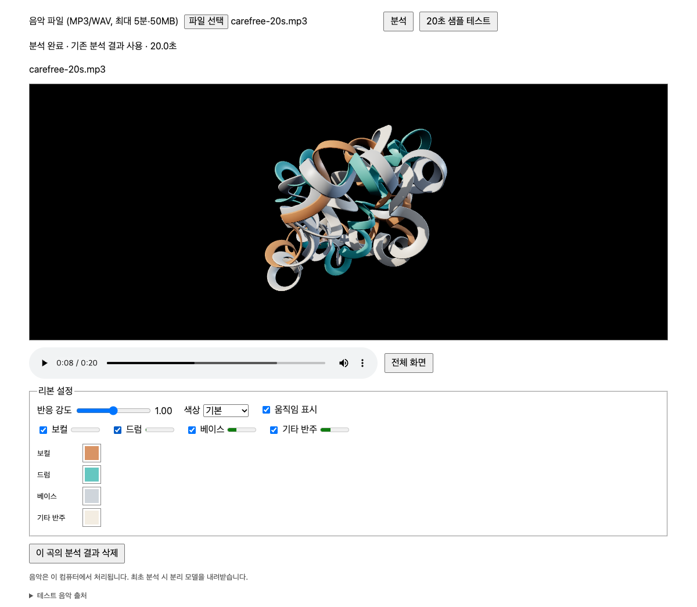

# Music Ribbon

Turn an MP3 or WAV file into animated 3D ribbons in your browser. Music Ribbon runs [Demucs](https://github.com/adefossez/demucs) locally to separate vocals, drums, bass, and other sounds. Each stem drives its own ribbon, built with geometry adapted from [fogleman/ribbon](https://github.com/fogleman/ribbon).



## Features

- Four audio-reactive ribbons with depth, folds, lighting, and shadows.
- A different, repeatable ribbon shape for each song.
- Playback, seeking, stem visibility, motion strength, fullscreen mode, and a compact color wheel for each ribbon.
- A bundled 20-second sample track for trying the app without supplying music.
- Local processing: your audio is not uploaded to a third-party service.

## Run locally

The tested setup is an Apple Silicon Mac with Python 3.12, FFmpeg, Google Chrome, and WebGL enabled. Install [uv](https://docs.astral.sh/uv/) and FFmpeg if needed:

```sh
brew install uv ffmpeg
```

Then, from the repository directory:

```sh
./start.command
```

Open **http://127.0.0.1:8765** if the browser does not open automatically. Stop the server with `Control+C`. The first run installs Python dependencies and downloads the Demucs model, so it needs an internet connection. The model runs on the CPU. Other operating systems and browsers have not been verified.

## Use

1. Choose or drag in an MP3 or WAV file (up to 5 minutes and 50 MB), then select **Analyze**. The interface is currently in Korean.
2. When analysis finishes, play or seek through the track with the audio controls. Ribbon motion follows the separated stems.
3. Adjust motion strength and visibility. Choose a color preset or click a stem's swatch to use the color wheel and brightness bar. Your custom colors persist in this browser.
4. Select **20-second sample test** to try the included track, or delete the current song's analysis data with the delete button.

Analysis is performed before playback, not in real time. A song's content determines its ribbon shape, so reopening the same analyzed song reproduces that shape. Quiet or absent stems may barely move.

## How it works

The pinned [Demucs commit](https://github.com/adefossez/demucs/tree/2883f3db65617d6d178c6ed10d869dc14e44e59b) produces four stems. The app extracts 50 Hz energy and onset data from each stem and uses those values to animate a WebGL mesh. Its ribbon geometry ports the cubic B-spline and swept cross-section ideas from the pinned [fogleman/ribbon commit](https://github.com/fogleman/ribbon/tree/568057efb726b6f8b8a5c6b067a27f411a77f487) to JavaScript. [Three.js](https://threejs.org/) renders the scene.

The server listens on the local loopback address. Uploaded audio, separated stems, and analysis results are saved under `data/`; downloaded model files are saved under `models/`. These directories are excluded from Git. The delete button removes one song's local analysis files, while keeping the model cache.

## Limits and testing

Only one analysis job runs at a time. The app does not isolate piano, use a microphone, export video, or provide a hosted service. Chrome and the local Mac setup above have been tested; separation quality has not been evaluated by listening.

To run the included checks after dependencies are installed:

```sh
.venv/bin/python -m pytest tests/test_backend.py -q
node --test tests/ribbon.test.mjs
```

The browser tests in `tests/` use Playwright and a local server. They were run during development, but Playwright is not installed by `start.command`.

## Credits and licenses

Demucs and fogleman/ribbon are MIT-licensed; their license texts are included as `DEMUCS-LICENSE.txt` and `RIBBON-LICENSE.txt`. Three.js is also MIT-licensed and its license is included in `web/vendor/THREE-LICENSE.txt`. See [THIRD_PARTY.md](THIRD_PARTY.md) for the exact versions and adaptation notes.

The bundled sample is a 20-second excerpt of “Carefree” by Kevin MacLeod, licensed under [CC BY 4.0](https://creativecommons.org/licenses/by/4.0/). See [samples/ATTRIBUTION.md](samples/ATTRIBUTION.md) for the source and changes. The music license is separate from the software licenses.
